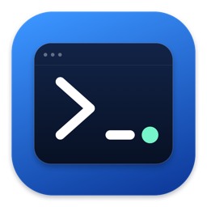
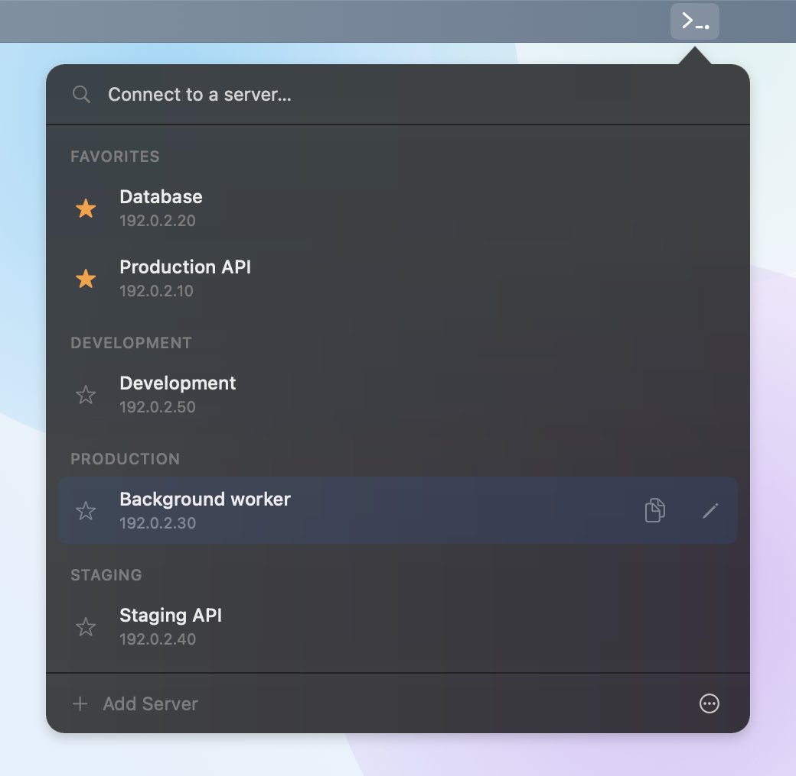

<p align="center">
  
</p>

# ShuttleNext

A macOS menu bar app for managing SSH connections. Uses system OpenSSH. Inspired by [Shuttle](https://github.com/fitztrev/shuttle).

Requires macOS 14 or later. Supports Apple Silicon and Intel builds.



## Installation

Download the DMG from [Releases](https://github.com/0x178F/shuttle-next/releases/latest): `arm64` for Apple Silicon or `x86_64` for Intel. Open it and drag ShuttleNext to Applications.

By default, builds are ad-hoc signed and not notarized.

## Build from source

Use Swift 6.2 or later, available with Xcode 26 or the corresponding Command Line Tools. Run from the project directory:

```sh
./scripts/build-app.sh
```

The script creates `dist/ShuttleNext.app` and `dist/ShuttleNext-<arch>.dmg` for the host architecture. Set `ARCH=arm64` or `ARCH=x86_64` to override it. Each build replaces the app bundle.

Move `dist/ShuttleNext.app` to `/Applications` and open it from there before saving passwords. Use the packaged app rather than `swift run`; SSH connections require its bundled helper.

## Usage

Supported terminals: Terminal.app, iTerm2, Ghostty, kitty, Alacritty, and WezTerm. Choose an installed terminal in Settings. macOS may ask for permission under **Privacy & Security → Automation**.

Import connections from OpenSSH config, classic Shuttle JSON, or ShuttleNext exports.

Choose a key file or paste a private key. New connections use OpenSSH defaults when no key is provided. Passwords are optional; key passphrases are requested separately. Leaving the password blank when editing keeps the saved password.

To move connections to another Mac:

1. Choose **… → Export**, enable **Include passwords and private-key files**, and set a backup password.
2. Import the `.shuttlenext` file on the other Mac, unlock it, and review the selection before confirming.

Existing connections are not overwritten.

## Data and security

- Connection metadata is stored locally as unencrypted JSON. Saved passwords are stored in macOS Keychain.
- Pasted and restored private keys are saved as files with owner-only permissions. The app does not add encryption or delete key files when servers are removed.
- JSON exports are unencrypted and exclude passwords and key contents. Encrypted `.shuttlenext` backups include them; ShuttleNext cannot reset a lost backup password. SSH configurations and agent/hardware identities are not bundled.
- Only use SSH configurations you trust: OpenSSH can execute commands from them when connecting.

## Development

```sh
swift test --disable-xctest --force-resolved-versions
swift test --configuration release --disable-xctest --force-resolved-versions
```

- `ShuttleCore`: shared models, storage, import/export, and SSH arguments.
- `ShuttleNext`: menu bar UI, terminal integration, and background library work.
- `ShuttleNextHelper`: SSH session lifecycle and authentication dialogs.

UI and authentication changes need a packaged-app smoke check.

Use a separate development library with `SHUTTLENEXT_DATA_DIR`. Do not share one library between running app instances. Keychain credentials are not isolated by this setting.

Do not commit real connection data, credentials, or signing material.

Successful pushes to `main` publish a release after tests and packaging. The first release uses the version in `Resources/Info.plist`; later releases increment the patch version. For a minor or major release, use **Actions → CI → Run workflow** on `main`. Use **Re-run failed jobs** to resume a failed publication.

## License

[MIT](LICENSE).
